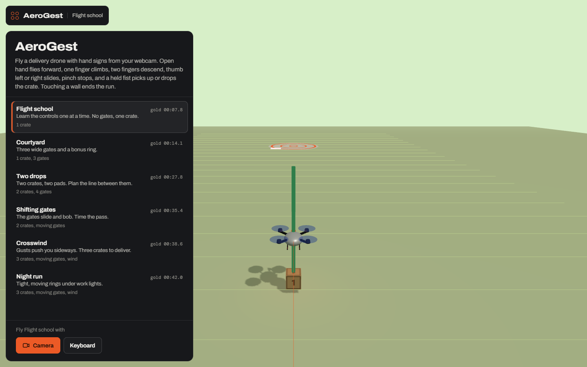
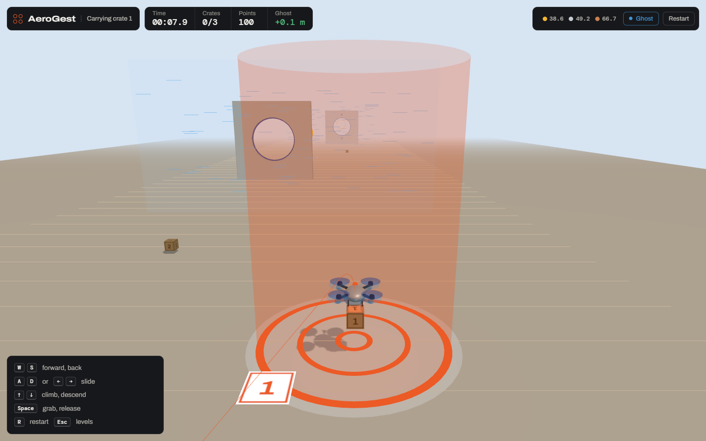
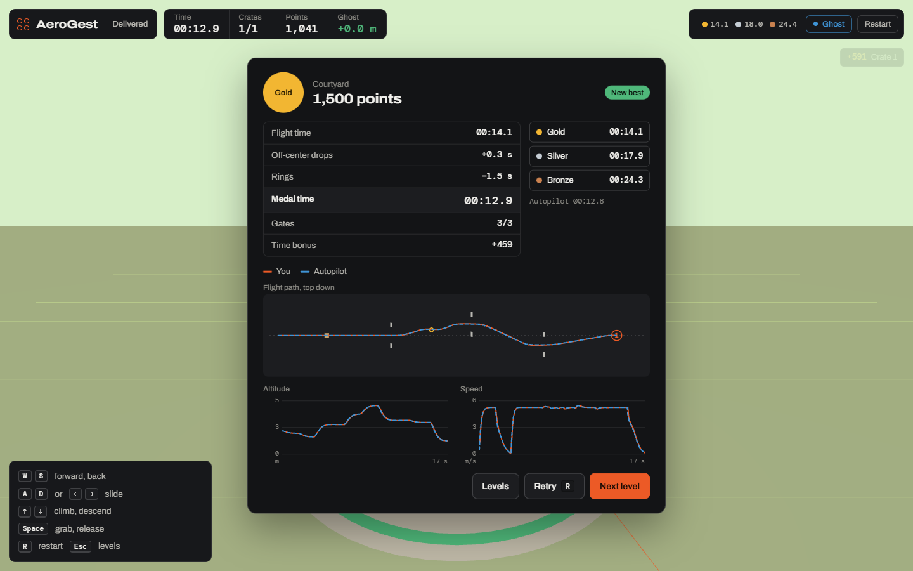

# AeroGest

Fly a delivery drone with hand signs from a webcam. Hand tracking (MediaPipe) runs in the browser; there is no backend.



## Gestures

| Pose | Drone |
| --- | --- |
| Open hand | Forward |
| Thumbs down | Back |
| One finger up, or thumbs up | Climb |
| Two fingers (V) | Descend |
| Fist, thumb to your right / left | Slide right / left |
| Pinch thumb and index | Stop and hover |
| Fist, held 0.35 s | Grab or drop the crate |

`src/control/gestures.ts` classifies each frame in three steps:

1. Finger bend from joint angles in MediaPipe's 3D world landmarks (independent of hand rotation), thumb direction in the mirrored image, pinch gap in cm.
2. MediaPipe's GestureRecognizer decides the poses it has classes for when it is confident; joint-angle rules handle the rest (sideways thumb, pinch).
3. A pose takes over after winning 5 of the last 7 frames (stop needs 3).

**Teach my hand** records two seconds of each pose and trains a k-NN classifier on your landmarks, with per-pose leave-one-out accuracy. It overrides the built-in classifier when confident and is saved in the browser.

Tests use a synthetic hand (finger chains with per-joint curl, projected to the image). MediaPipe's sample photos, streamed through the app as a fake webcam, were all classified correctly.

## Game



Six levels: a guided flight school, then gates, two- and three-crate deliveries, sliding and bobbing gates, crosswinds, and a night level with tight rings.

- Touching a wall crashes the drone and ends the run.
- Points: 100 per gate, 150 per bonus ring, 400 per crate plus up to 200 for landing it on the pad center, and 40 per second under the bronze time.
- Medals are set from the autopilot's time on each level (gold within 10%, silver 40%, bronze 90%).
- Your best run replays as a ghost; until you have one, the autopilot's run does.



The autopilot flies the menu demo and sets the reference times. It outputs the same command as a hand or keyboard, so it goes through the same physics and scoring. A test requires it to finish every level through every gate without a crash.

## Run

```bash
npm install
npm test
npm run dev        # http://127.0.0.1:5173
```

Hand tracking needs Chrome or Edge and a webcam; the model (about 18 MB) downloads on first use. Keyboard: `W` `S` forward and back, `A` `D` slide, `↑` `↓` climb and descend, `Space` grab, `R` restart, `Esc` levels. Phones get touch sticks.

## Deploy

`render.yaml` is a Render Blueprint for a static site: **New → Blueprint**, pick the repo. Render runs `npm ci && npm test && npm run build` and serves `dist/`.

## Code

```text
src/control/gestures.ts   Pose classifier, voting, personal k-NN
src/vision/tracker.ts     Camera and GestureRecognizer
src/physics/drone.ts      Drone model with wind
src/course/               Levels, crash and gate tests, deliveries, points
src/autopilot/            Autopilot, reference runs, medals
src/scene/world.ts        three.js scene
src/main.ts               Modes and frame loop
```
